<div align="center">

<picture>
  <source media="(prefers-color-scheme: dark)" srcset="docs/readme/logo-dark.svg">
  
</picture>

# Kairos

**Make videos with Claude Code. Watch them come alive, point at the frame that's wrong, and Claude makes it right.**

[](LICENSE)
[](https://nodejs.org)

</div>

<table>
  <tr>
    <td width="64%" align="center">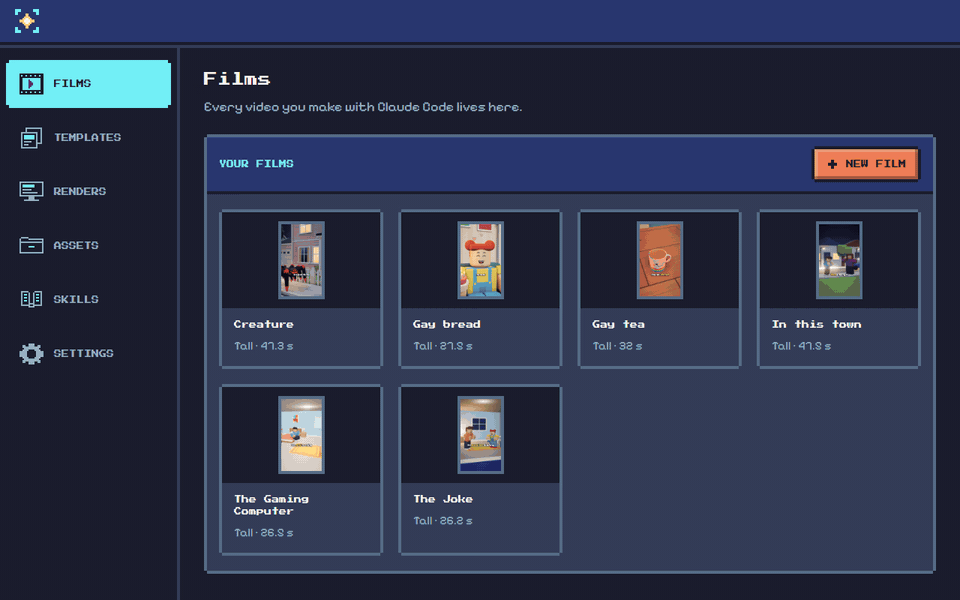</td>
    <td align="center">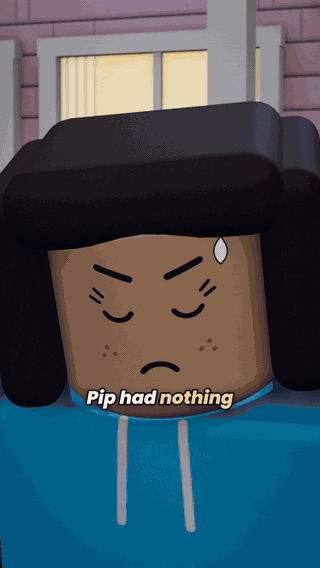</td>
  </tr>
  <tr>
    <td align="center"><sub>Kairos at work</sub></td>
    <td align="center"><sub>"Creature", made with Blocky</sub></td>
  </tr>
</table>

<p align="center">Please leave a ⭐ as motivation if this was helpful!</p>

## What is Kairos?

Claude Code writes your film as code: a small web page that can draw any moment of it. Kairos plays that page live
while Claude works, lets you stop on any frame and leave a note on it (Claude sees your note and the picture), and
turns the film into a video for YouTube, Shorts or a square post. It all runs on your computer.

_Kairos_ is Greek for the right moment: the one frame you stop on, and get just right.

## What you can do

-  **Make a film from a story.** Pick a
  template, write your story, and Claude makes the film while you watch.
-  **See it live.** The preview updates every
  time Claude saves a file.
-  **Point at what's wrong.** Pause, draw a box
  or an arrow on the frame and say what should change. Claude reads your notes with their pictures and fixes them.
-  **Ask Claude right in the app.** No terminal
  needed (it's still there if you like it: More → Open Claude here).
-  **Edit on a timeline.** Music, sound
  effects, voices and your own video clips, each on its own lane.
-  **Give it a voice.** Claude writes the
  narration and the characters' lines, fish.audio speaks them, and the captions follow every word.
-  **Export for anywhere.** MP4 for YouTube,
  Shorts, TikTok, Reels or a square post, with a subtitles file and cover pictures.
-  **Make it yours.** Save any film as a
  template, and teach Claude your own style with skills.

## Templates

A template is a ready start for one kind of film: its look, the engine that draws it, and the few questions New film
asks you (your story, the mood, where it happens). Pick one, answer, and Claude builds your film from it. Kairos
will bring more templates over time, and you can turn any film of yours into one (**More → Save as template**).

### Blocky

The first template: narrated stories with toy characters, filmed like an animated movie. The figures are jointed toys
that walk, run, sit, jump over furniture, pick things up, throw them, punch and fall, all by real physics. The light
is cinematic, the camera finds its own way around the furniture, and the narrator never stops while the captions pop
word by word. There are ten places to film in: home, bedroom, kitchen, school, classroom, café, town, park, backyard
and a snowy forest.

<p align="center">
  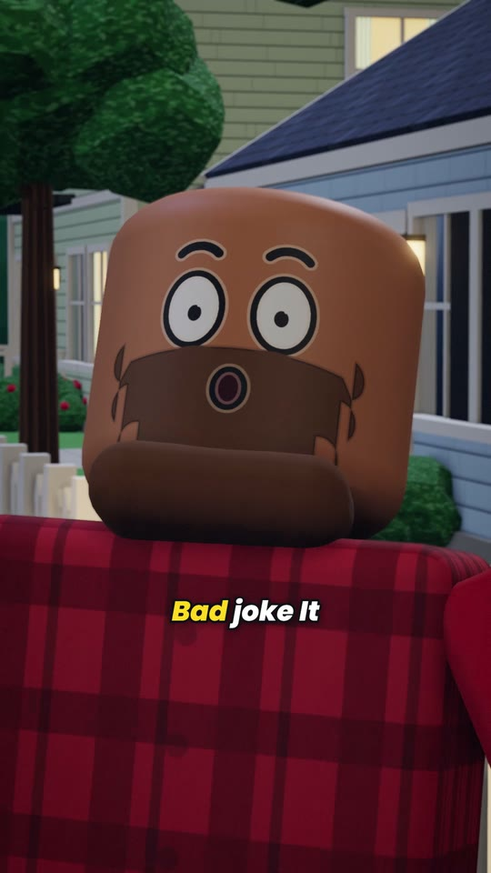
  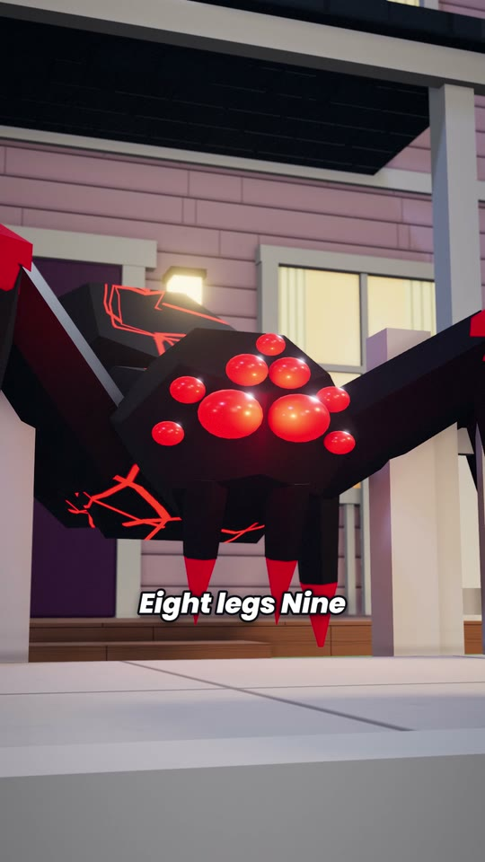
  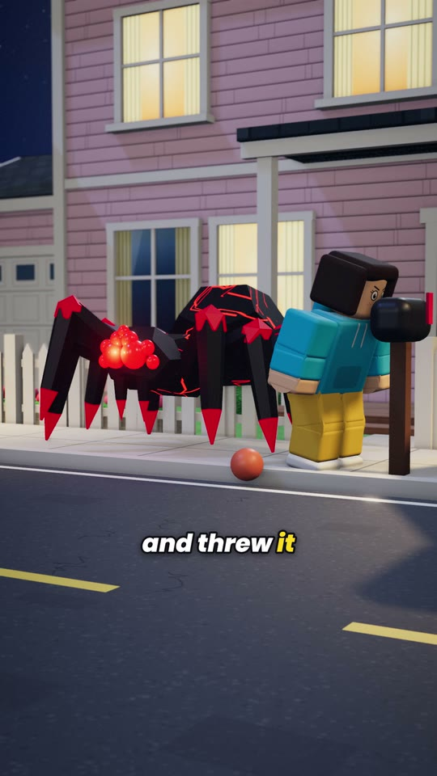
  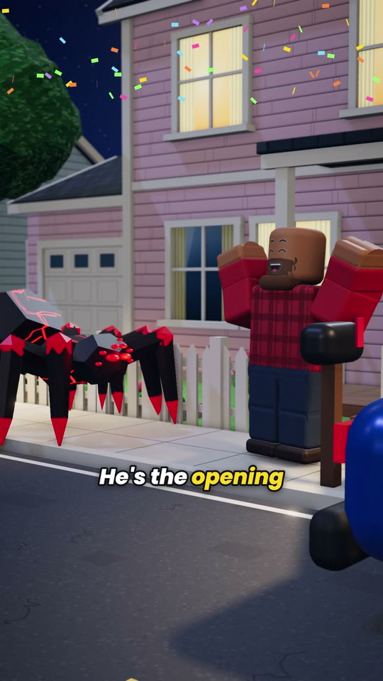
  <br>
  <sub>Frames from "Creature", a film made with Blocky</sub>
</p>

## What you need

- **Node.js 24** or newer
- **ffmpeg** on your PATH, to make videos
- **Google Chrome or Microsoft Edge**: Kairos uses it, hidden, to take pictures of frames and to render
- **Claude Code**, signed in with your Claude plan
- Recommended: a **fish.audio** API key, for the full experience: narration, character voices and captions that
  follow every word. Speaking uses your fish.audio credits.

Kairos runs on Windows, macOS and Linux.

## Quick start

```sh
git clone https://github.com/zehmbot/kairos.git
cd kairos
npm install
npm run build
npm start
```

Open <http://127.0.0.1:7340>, choose the folder for your films, then go to **Settings → Claude Code → Connect**.
For the full experience, add your fish.audio API key in **Settings → Voice** too: your films get their voices. That's
it: press **New film**.

## Your first film

1. **New film → From a template → Blocky.**
2. **Write your story** the way a narrator would tell it, and leave **Claude makes it now** on.
3. **Watch Claude make it.** The preview shows what Claude is doing; **Peek** shows the film underneath.
4. **Leave a note, then render.** Pause on a frame, draw on it, say what to change and press **Fix my notes** in the
   Claude tab. When you love it, press **Render**.

<table>
  <tr>
    <td>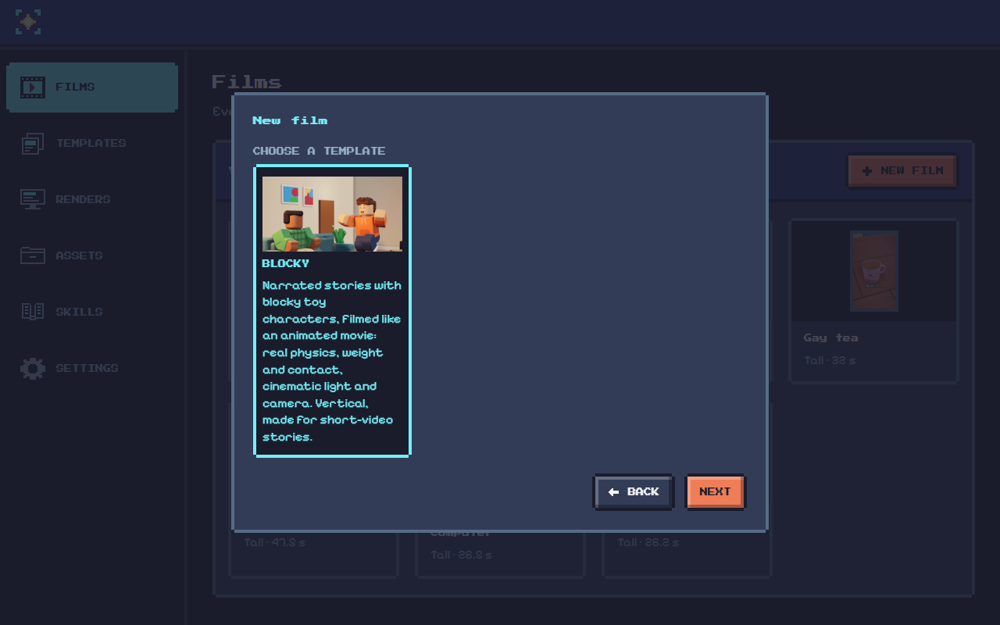</td>
    <td>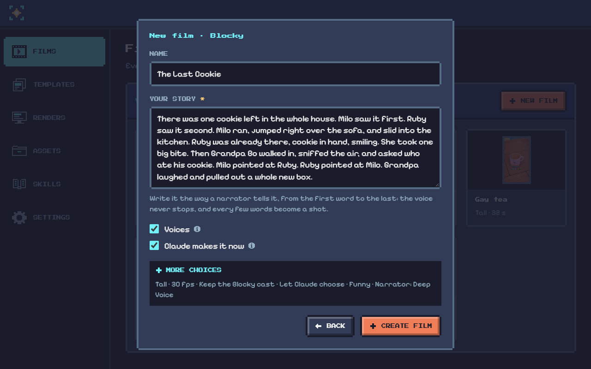</td>
  </tr>
  <tr>
    <td>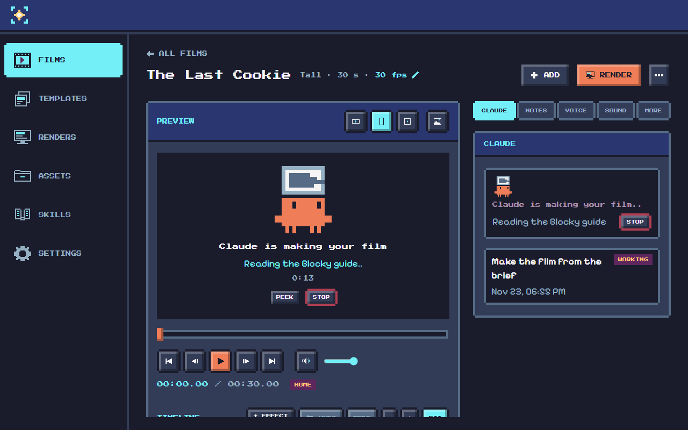</td>
    <td>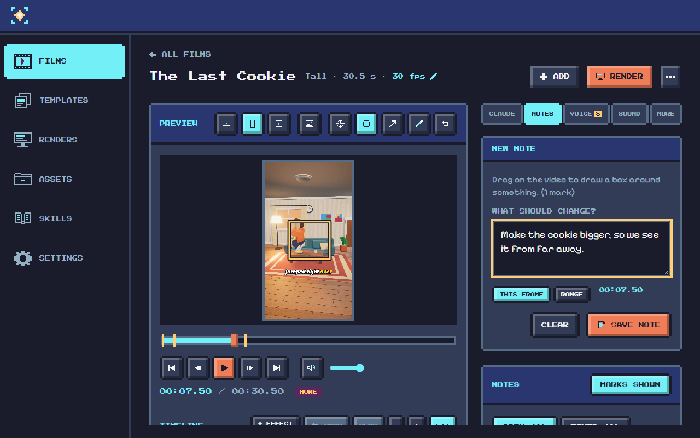</td>
  </tr>
</table>

## How it works

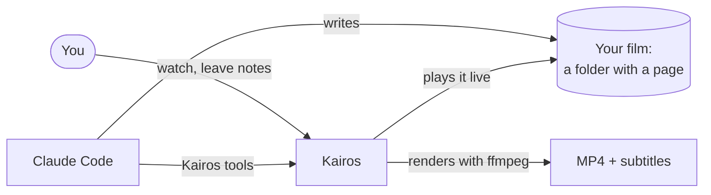

A film is just a folder with a `kairos.json` and a web page that draws any moment you ask for:

```json
{ "title": "Hello", "width": 1920, "height": 1080, "fps": 30, "duration": 5 }
```

```html
<canvas id="c" width="1920" height="1080"></canvas>
<script>
  const ctx = document.getElementById("c").getContext("2d");
  // Draws the frame at t seconds. The same t always gives the same picture.
  window.renderOut = (t) => {
    ctx.fillStyle = "#1a1c2c";
    ctx.fillRect(0, 0, 1920, 1080);
    ctx.fillStyle = "#ffcd75";
    ctx.fillRect(860 + Math.sin(t * 2) * 600, 440, 200, 200);
  };
</script>
```

Because every frame depends only on its time, Kairos can show any frame at once, take a picture of it for Claude,
and render the film in several pieces at the same time. Claude reaches Kairos through the Kairos tools (an MCP
server): it reads your notes, looks at frames, makes voices and renders.

## Everything stays on your computer

- Kairos listens only on 127.0.0.1: nothing else on your network can reach it.
- Your films are plain folders in the folder you chose, and videos are rendered on your machine.
- Your fish.audio key stays in `~/.kairos/.env`, never in a film or in the browser.
- Only voice work goes to fish.audio (the lines you have spoken, and sounds you ask it to listen to), and Claude
  Code talks to Anthropic as it always does.

## Make it yours

- **Templates:** open any film and choose **More → Save as template**. Its questions become the form New film
  shows.
- **Skills:** write your own on the **Skills** page (your style, your brand colors, how you like your captions).
  Claude uses them next to Kairos' own guides.

## Roadmap

- Templates made from your own reference videos
- Faster renders
- More templates
- Install with one command from npm

## Contributing

Kairos is TypeScript all the way through: a Fastify hub, a React UI and the Kairos tools for Claude Code.
[CLAUDE.md](CLAUDE.md) is the guide to how it's built (and yes, Claude reads it too). Before a pull request:

```sh
npm run dev    # the app with hot reload on http://127.0.0.1:7341
npm test
npm run lint
```

Commits follow [Conventional Commits](https://www.conventionalcommits.org) (`feat:`, `fix:`, ...).

## Credits

Built with [three.js](https://threejs.org), [Rapier](https://rapier.rs) (physics), React, Fastify, Vite,
puppeteer-core and the Model Context Protocol SDK. Voices by [fish.audio](https://fish.audio). Fonts:
Press Start 2P by CodeMan38 and Pixelify Sans by Stefie Justprince, both under the SIL Open Font License. Colors:
the [Sweetie-16](https://lospec.com/palette-list/sweetie-16) palette by GrafxKid.

Claude, Claude Code and the Claude character belong to Anthropic. Kairos is an independent project.

## License

[MIT](LICENSE)
